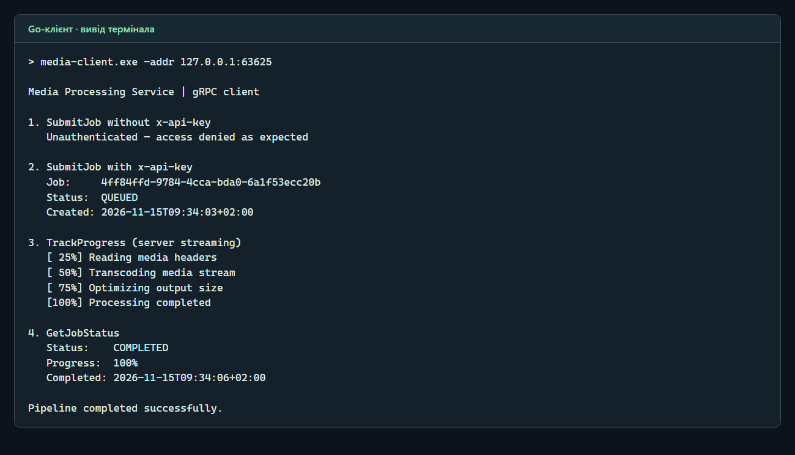

# Практична робота № 7. Міжсервісна взаємодія через gRPC

Media Processing Service реєструє завдання, повертає їхній статус і передає прогрес через серверний потік. gRPC-виклики працюють через HTTP/2 з повідомленнями Protobuf. Стадії обробки медіа імітуються таймером, а завдання зберігаються в пам’яті до перезапуску сервера.

## Запуск

Потрібен Go 1.22 або новіший. У першому терміналі PowerShell виконайте з каталогу проєкту:

```powershell
go mod download
go run ./cmd/server
```

У другому терміналі виконайте:

```powershell
go run ./cmd/client
```

Сервер за замовчуванням слухає `127.0.0.1:50051`. Клієнт спочатку перевіряє, що виклик без ключа повертає `Unauthenticated`, потім створює завдання, отримує прогрес `25 → 50 → 75 → 100%` і викликає `GetJobStatus`, щоб підтвердити `COMPLETED`.

Параметри запиту можна змінити через `-client-id`, `-filename`, `-format` і `-quality`. Для іншої адреси використайте `-addr` в обох командах. Підключення призначене для локальної демонстрації та працює без TLS. Демо-ключ `secret-media-token` можна замінити, встановивши однакове значення `MEDIA_API_KEY` в обох терміналах перед запуском.

## Контракт і поведінка

| RPC | Тип | Поведінка |
| --- | --- | --- |
| `SubmitJob` | Unary | Перевіряє параметри, присвоює UUID v4 і повертає `QUEUED` з Unix-часом створення. |
| `GetJobStatus` | Unary | Повертає статус, прогрес і час завершення. Невідомий ідентифікатор дає `NotFound`. |
| `TrackProgress` | Server Streaming | Повертає послідовність стадій. За `100%` поле `is_completed` набуває значення `true`. |

`client_id` і `filename` обов’язкові. Підтримуються `PNG`, `JPEG`, `WEBP` і `MP4`, якість від 1 до 100. Некоректний запит повертає `InvalidArgument`.

Перший виклик `TrackProgress` запускає обробку зареєстрованого завдання. Кілька клієнтів можуть стежити за ним одночасно, використовуючи один таймер завдання. Після відключення останнього спостерігача робота зупиняється зі збереженим прогресом. Новий спостерігач отримує вже пройдені етапи й відновлює обробку з наступного етапу. Готове завдання повертає всі чотири етапи й завершує потік.

Перехоплювачі перевіряють `x-api-key` для Unary та Streaming RPC. У логах є метод, адреса клієнта, результат автентифікації, код gRPC і тривалість виклику.

## Повторна генерація Protobuf

Згенеровані `proto/media.pb.go` і `proto/media_grpc.pb.go` вже є в репозиторії. Для повторної генерації встановіть `protoc` і плагіни. `protoc` і каталог Go з установленими плагінами мають бути в `PATH`.

```powershell
go install google.golang.org/protobuf/cmd/protoc-gen-go@v1.36.6
go install google.golang.org/grpc/cmd/protoc-gen-go-grpc@v1.5.1
protoc '--go_out=.' '--go_opt=paths=source_relative' '--go-grpc_out=.' '--go-grpc_opt=paths=source_relative' proto/media.proto
```

## Перевірка через grpcurl

Команди використовують демо-ключ і локальний сервер за замовчуванням. Параметр `-proto` завантажує контракт безпосередньо з файлу.

```powershell
$request = @{ clientId='grpcurl-demo'; filename='photo.png'; targetFormat='MEDIA_FORMAT_WEBP'; qualityLevel=90 } | ConvertTo-Json -Compress
$conn = @('-plaintext', '-import-path', '.', '-proto', 'proto/media.proto')
$auth = @('-H', 'x-api-key: secret-media-token')

# Спроба без ключа має повернути Unauthenticated
$request | grpcurl @conn -d '@' localhost:50051 media.MediaService/SubmitJob

$job = $request | grpcurl @conn @auth -d '@' localhost:50051 media.MediaService/SubmitJob | ConvertFrom-Json
$query = @{ jobId=$job.jobId } | ConvertTo-Json -Compress
$query | grpcurl @conn @auth -d '@' localhost:50051 media.MediaService/GetJobStatus
$query | grpcurl @conn @auth -d '@' localhost:50051 media.MediaService/TrackProgress
$query | grpcurl @conn @auth -d '@' localhost:50051 media.MediaService/GetJobStatus
```

## Результати перевірки

Успішно виконано `go test -count=3 ./...`, `go vet ./...` і `go build ./...`. Тести охоплюють автентифікацію всіх методів, валідацію, невідомі завдання, кілька спостерігачів, скасування й відновлення обробки. Go-клієнт і вісім викликів `grpcurl` перевірено через реальний TCP-порт. Очікувані відмови `Unauthenticated`, `NotFound` та `InvalidArgument` підтверджують негативні сценарії.

Зображення сформовано зі збереженого виводу термінала під час цих перевірок.



- [Логи gRPC-сервера з кодами статусів і тривалістю RPC](docs/screenshots/grpc-server.png)
- [Приклади відповідей `grpcurl`](docs/screenshots/grpcurl.png)

## Контрольні питання

1. **Чим gRPC відрізняється від REST поверх HTTP/1.1?** gRPC описує методи та структури даних у контракті `.proto` і зазвичай використовує бінарний Protobuf поверх HTTP/2. HTTP/2 мультиплексує потоки в одному з’єднанні. REST організовує взаємодію навколо ресурсів, часто використовує JSON і може працювати поверх різних версій HTTP.
2. **Для чого потрібні номери полів Protobuf?** Номер і тип кодування позначають поле у двійковому повідомленні. Якщо змінити номер, старі клієнти не розпізнають поле, а повторне використання номера може спотворити сенс даних. Номери вилучених полів резервують через `reserved`.
3. **Чим відрізняються скалярні типи й `enum`?** Скалярні типи описують окремі значення, наприклад числа, рядки чи `bool`. `enum` задає іменовані числові стани. Перше значення в proto3 має номер 0 та слугує типовим значенням. Зазвичай це `UNSPECIFIED`.
4. **Які є типи RPC?** Unary передає один запит і одну відповідь. Server Streaming повертає потік на один запит. Client Streaming приймає потік і повертає одну відповідь. Bidirectional Streaming дозволяє потоки в обидва боки. Server Streaming підходить, наприклад, для прогресу завдання або потоку записів.
5. **Як передаються помилки?** Обробник повертає помилку зі стандартним кодом і описом, наприклад `status.Error(codes.NotFound, "...")`. Клієнт читає код зі статусу RPC і може обробити його програмно незалежно від тексту опису.
6. **Що таке Metadata?** Це додаткові пари ключ–значення для виклику. Власні ключі, як `x-api-key`, і службові поля gRPC передаються в заголовках HTTP/2. Сервер також може повернути кінцеві метадані в трейлерах, де передається `grpc-status`.
7. **Як працює Unary Interceptor?** Перехоплювач отримує контекст, запит, дані методу та `handler`. Він може відхилити виклик, викликати `handler` після перевірки ключа, а після відповіді зафіксувати код і тривалість.
8. **Навіщо перевіряти `stream.Context().Done()`?** Канал сповіщає про скасування або сплив дедлайну. Обробник може завершити очікування, відписати клієнта й зупинити таймер, коли спостерігачів більше немає.

Джерела для контрольних питань. [Основи gRPC для Go](https://grpc.io/docs/languages/go/basics/), [протокол gRPC поверх HTTP/2](https://github.com/grpc/grpc/blob/master/doc/PROTOCOL-HTTP2.md), [посібник proto3](https://protobuf.dev/programming-guides/proto3/).
